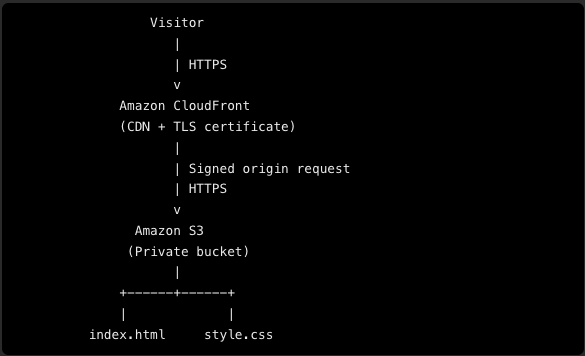
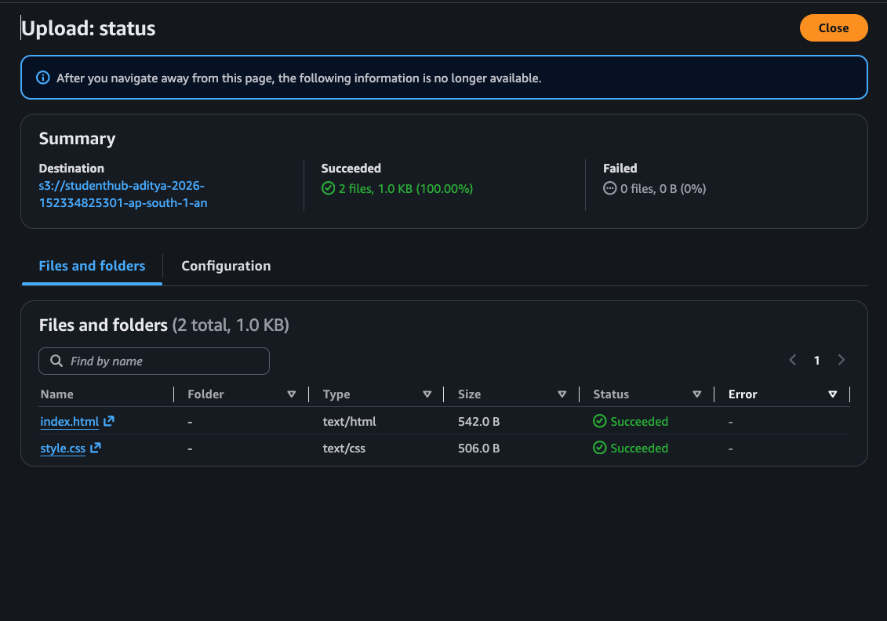
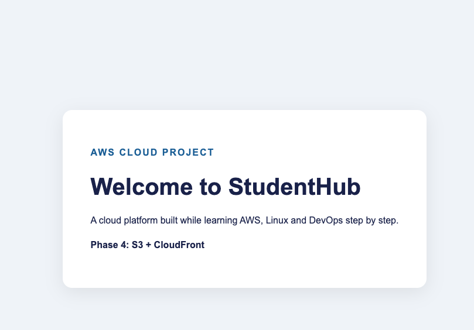
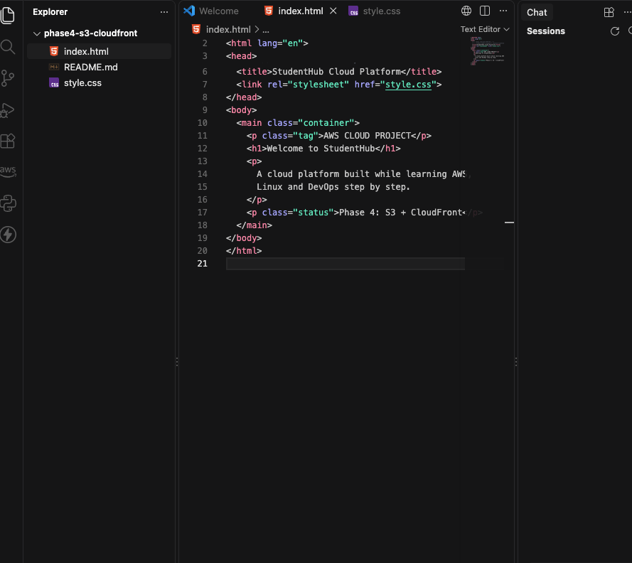
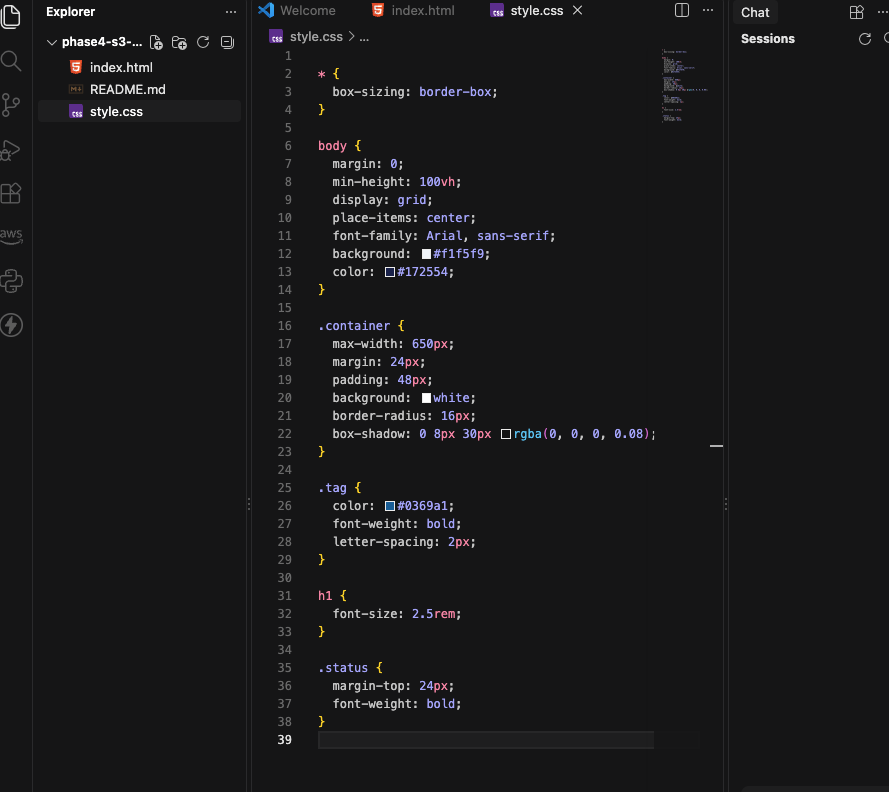

This is Phase 4 of my StudentHub Cloud Platform project, where I explored hosting a static website using AWS storage and content delivery services.

### 1. What I Built

I built and deployed a static website using Amazon S3 and Amazon CloudFront. The website files include an HTML page and a CSS stylesheet.

### Architecture

The website files are stored in Amazon S3, while Amazon CloudFront provides a distribution URL to access the website.

### Amazon S3 — Website Storage

I created an S3 bucket and uploaded the website files required to serve the static content.

### Amazon CloudFront — Content Delivery

I configured a CloudFront distribution and used its domain name to access the deployed website.

### Website Deployment

After configuring the services, I opened the CloudFront URL to verify that the website was accessible.

Website homepage:

Website styling:

### 2. What I Learned

Through this phase, I strengthened my understanding of the following AWS and web hosting concepts:

Amazon S3: How to store website assets in an S3 bucket.

Amazon CloudFront: How a content delivery network (CDN) distributes website content.

Static website hosting: How HTML and CSS files work together to deliver a website.

Cloud deployment: How to configure AWS resources and verify a deployment using its public endpoint.

Troubleshooting: Why validating the website after configuration is important.

Documentation: How to record architecture, implementation steps, and screenshots for a cloud project.
