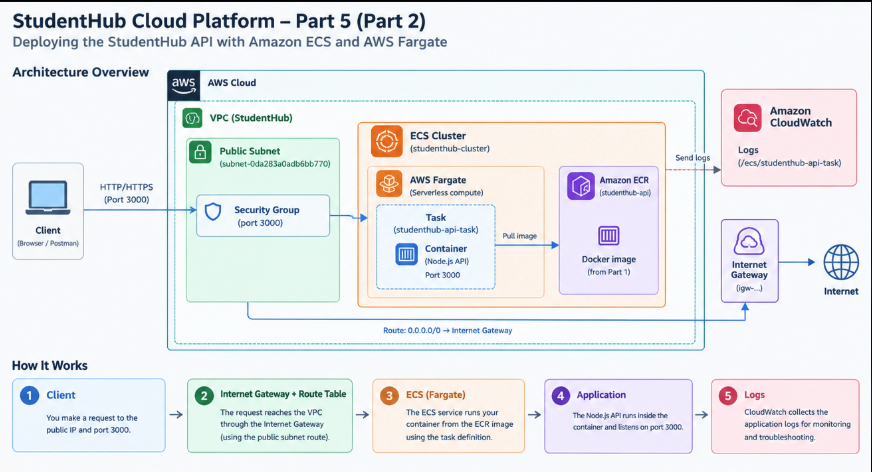
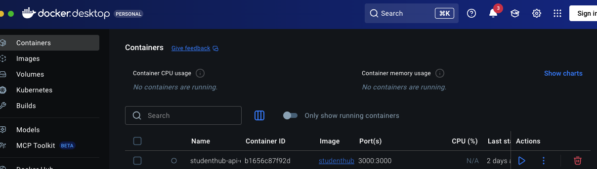
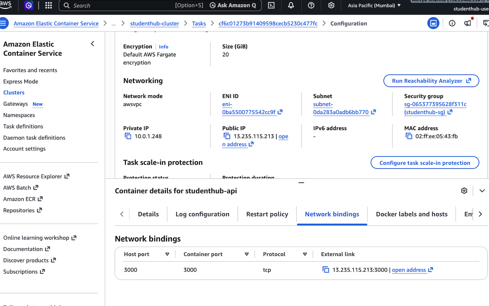
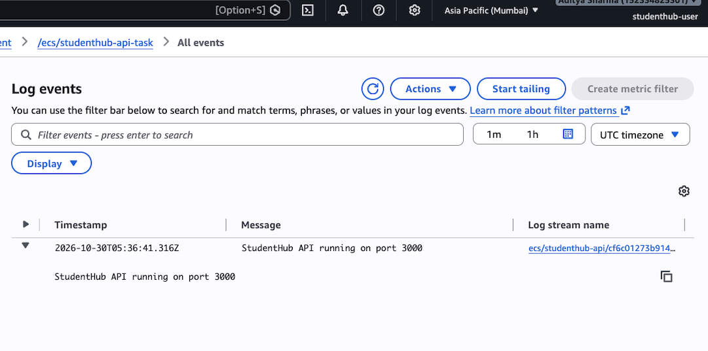

# Phase 5: Amazon ECR and ECS

## Overview

In this phase of the StudentHub Cloud Platform project, I am learning how to containerize a web application using Docker, store the container image in Amazon Elastic Container Registry (ECR), and deploy it using Amazon Elastic Container Service (ECS) with AWS Fargate.

## Objectives

- Build a Docker image for the StudentHub website.
- Test the container locally.
- Store the Docker image in Amazon ECR.
- Deploy the container using Amazon ECS and AWS Fargate.
- Verify the deployed application.

## Architecture

**Deployment flow:**

 `Website Files → Docker Image → Amazon ECR → Amazon ECS → AWS Fargate → Web Browser`
  
### ECS Architecture

## Technologies Used

- **Docker:** Containerizes the website.

### Docker Image

- **Amazon ECR:** Stores Docker container images.
- **Amazon ECS:** Manages container deployment.

### ECS Cluster

- **AWS Fargate:** Runs containers without managing EC2 instances.
- **Nginx:** Serves the website.
- **AWS IAM:** Manages permissions for AWS resources.
### CloudWatch Logs

## What I Built

- Created a Dockerfile for the StudentHub website.
- Built and tested the Docker image locally.
- Created a private ECR repository.
- Pushed the Docker image to ECR.
- Created an ECS task definition.
- Created an ECS cluster and service using Fargate.
- Verified that the ECS task was running.
- Accessed the deployed website through its public endpoint.

## What I Learned

- How to package a website into a Docker image.
- How to run and test containers locally.
- How to push Docker images to Amazon ECR.
- How ECS clusters, task definitions, tasks, and services work together.
- How AWS Fargate runs containers without managing EC2 instances.
- How to verify a containerized application deployment.

## Security and Cost Management

- Use IAM roles and least-privilege permissions.
- Keep AWS access keys and other secrets out of GitHub.
- Review AWS pricing before deploying resources.
- Avoid unnecessary networking resources, such as NAT gateways.
- Delete or stop resources when they are no longer needed, while checking for resources that continue to incur charges.

## Outcome

The goal of this phase is to understand the container deployment workflow by moving from a locally tested Docker image to an application running on Amazon ECS.

**Project:** StudentHub Cloud Platform
**Phase:** 5 — Amazon ECR and ECS

