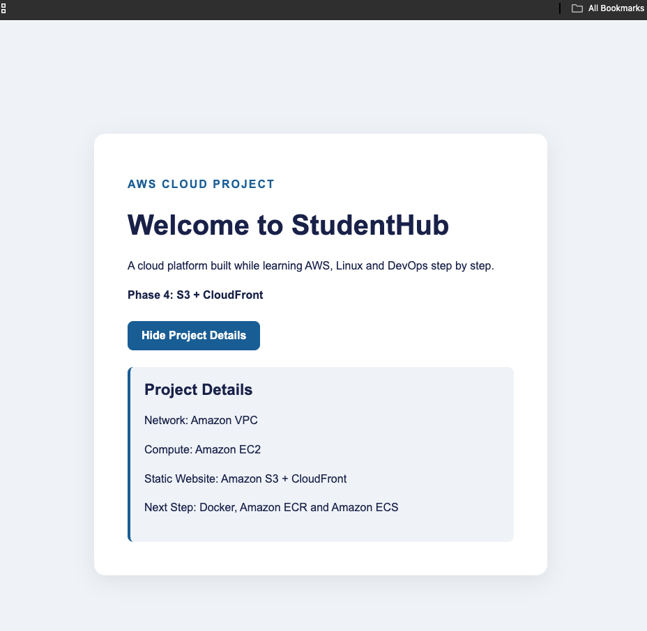
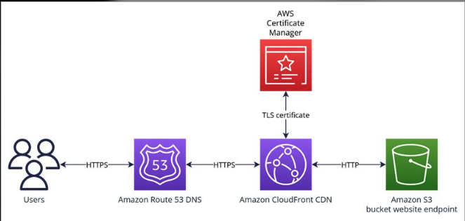

# Phase 6: route53

## What I Built

- Explored DNS and how domain names are resolved.
- Studied Amazon Route 53 and its role in DNS management.
- Understood how DNS records connect domain names to AWS services.
- Explored how a custom domain can be connected to an Amazon CloudFront distribution.
- Verified the existing StudentHub website through its CloudFront distribution.
- Tested the website's HTML, CSS and JavaScript functionality.

**Note:** Custom domain registration and Route 53 configuration were studied but not implemented.

## Screenshots

### 1. StudentHub Website on CloudFront

### 4. DNS Architecture

## What I Learned

- How DNS translates domain names into destinations.
- Difference between A, CNAME and Alias records.
- What DNS hosted zones and nameservers do.
- How Amazon Route 53 manages DNS records.
- How Route 53 can route traffic to CloudFront.
- How SSL/TLS certificates enable HTTPS for custom domains.
- How CloudFront delivers static website content globally.

**Key Takeaway:** DNS makes applications accessible through human-readable domain names, while CloudFront helps deliver website content securely and efficiently.
