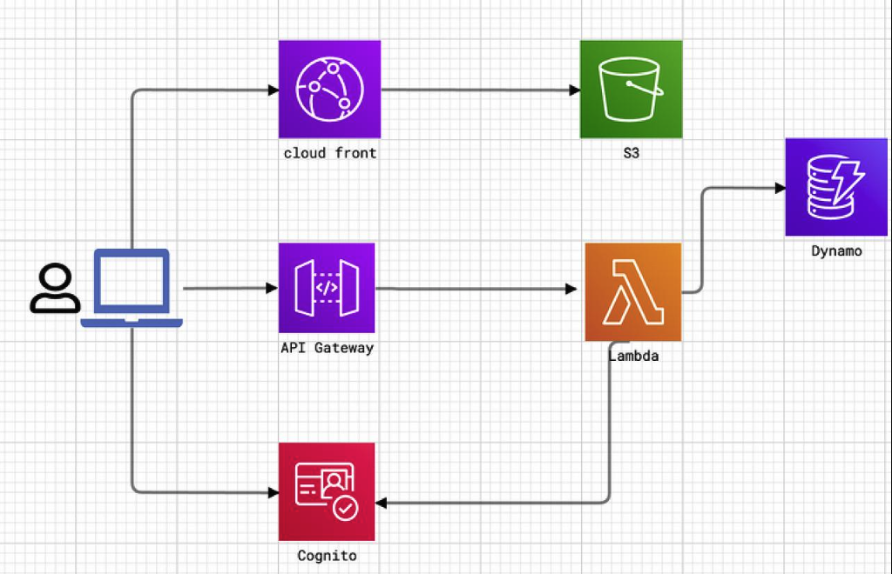
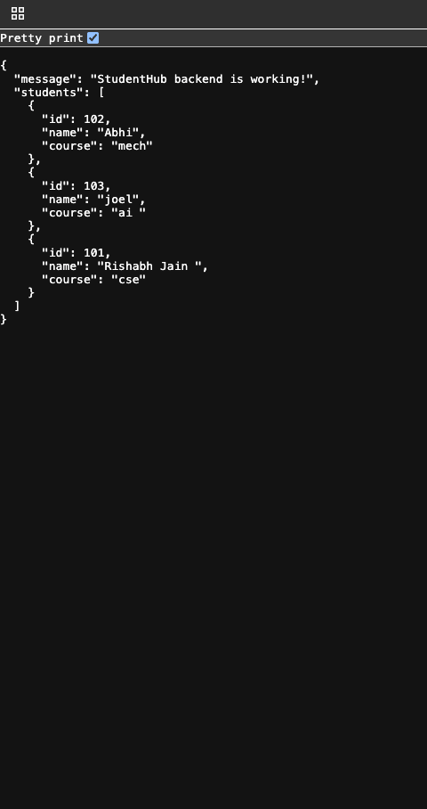
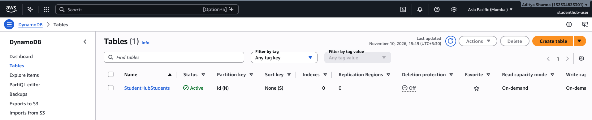
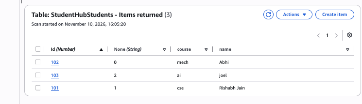
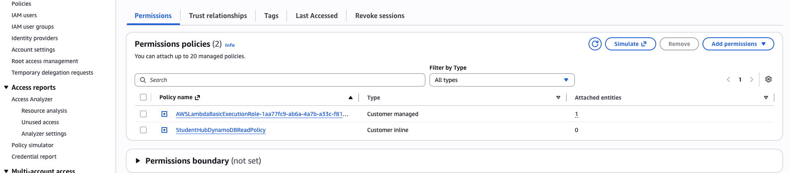
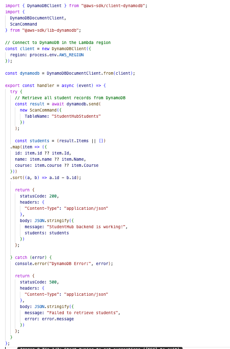
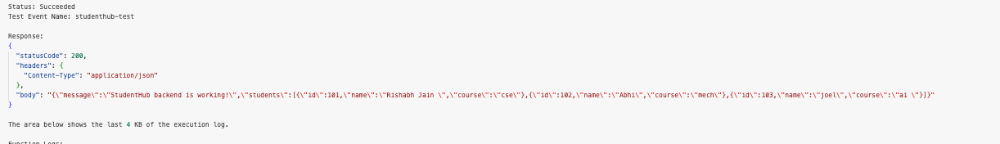
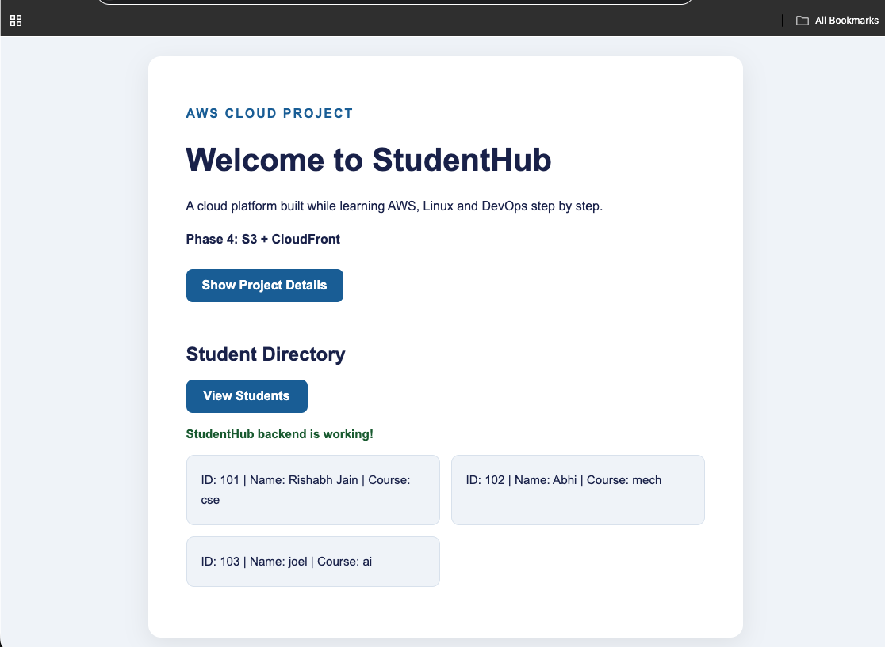

# Phase 7: lambda

## What I built
In this phase, I built a serverless backend for the StudentHub application using AWS Lambda, Amazon API Gateway, and Amazon DynamoDB.
### Architecture Diagram

## Part 1: AWS Lambda & API Gateway
- Created an AWS Lambda function using Node.js 22.x.
- Created an HTTP API using Amazon API Gateway.
- Configured the GET /api/students route.
- Connected API Gateway with the Lambda function.
- Tested the API endpoint successfully.

### API Response – StudentHub Backend JSON

- Connected the StudentHub frontend to the backend.

## Part 2: Amazon DynamoDB
- Created a DynamoDB table named StudentHubStudents.

### DynamoDB Table

- Configured id as the partition key with Number type.
- Added student records to the table.

### DynamoDB Items

- Configured IAM permissions for Lambda to access DynamoDB.

### IAM Permission

- Integrated DynamoDB with Lambda using the AWS SDK.

### Lambda Code

- Retrieved student records using the Scan operation.
- Implemented ascending order sorting by student ID.

### Lambda Test

- Connected the database-backed API to the StudentHub frontend.

### Frontend with Backend Integration

- Verified that student records were displayed dynamically on the website.

## What I learned
- Understanding serverless architecture.
- Creating and configuring AWS Lambda functions.
- Creating HTTP APIs using Amazon API Gateway.
- Understanding API routes and Lambda integrations.
- Understanding NoSQL databases and Amazon DynamoDB.
- Learning about partition keys and sort keys.
- Understanding DynamoDB Scan and Query operations.
- Integrating AWS services using the AWS SDK for JavaScript.
- Configuring IAM execution roles and inline policies.
- Applying the Principle of Least Privilege.
- Connecting a frontend with a serverless backend.
- Understanding how data flows between the frontend, API Gateway, Lambda, and DynamoDB.
- Troubleshooting database attributes, API responses, and IAM permissions.
- Understanding pagination and AWS cost considerations.

Status: Completed
